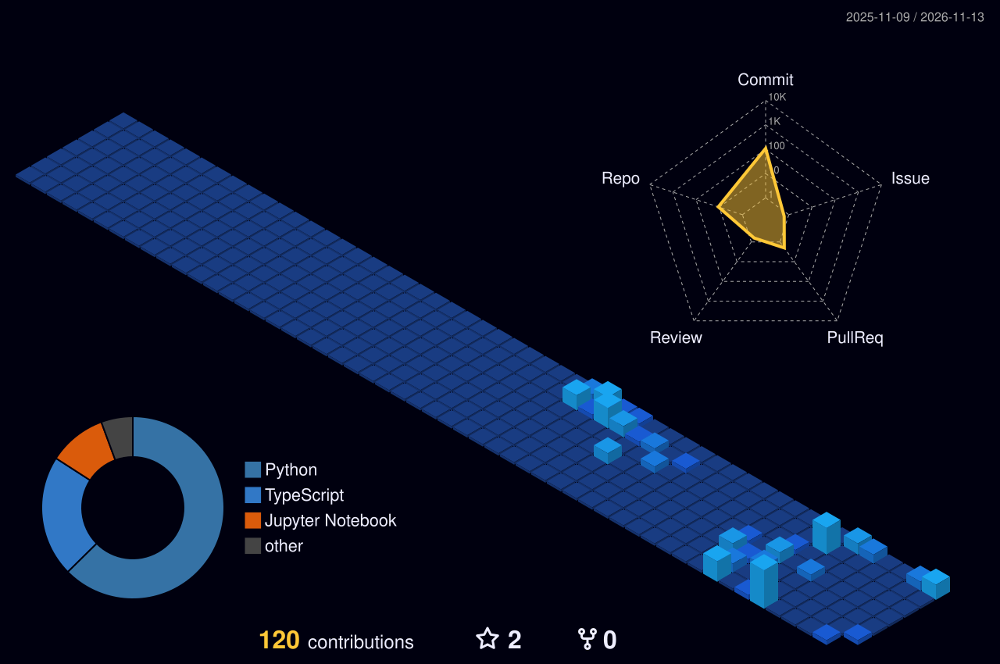

New York, NY

---

### About

- CS & Economics (Math minor) at **CUNY Hunter College** · GPA 3.93
- **Software Engineer Intern**, Break Through Tech AI Studio × Hollywood Studios — secure script sharing and writing tools for filmmakers
- **Undergraduate TA**, Intro to Computer Science at Hunter
- Off the keyboard: hand-drawn art, and turning it into Three.js / WebGL scenes

### Currently building

<!--START_SECTION:building-->
- **[hunter-spatial](https://github.com/YunzheOVE/hunter-spatial)** — An interactive 3D spatial campus navigator and class wayfinding engine for CUNY Hunter College.  
  `TypeScript` · pushed 22 hours ago
- **[ascend](https://github.com/YunzheOVE/ascend)** — Local LeetCode-style judge for usaco.guide problems  
  `Python` · pushed 5 days ago
- **[dp-subgroup-disparity](https://github.com/YunzheOVE/dp-subgroup-disparity)**  
  `Python` · pushed 36 days ago
<!--END_SECTION:building-->

### Selected work

| Project | What it is | Stack |
| :-- | :-- | :-- |
| **[Hunter Spatial](https://github.com/YunzheOVE/hunter-spatial)** · [demo](https://hunter-spatial-web.vercel.app) | Lead dev, capstone. 3D indoor navigation for 2,800+ rooms across 5 Hunter buildings, with in-browser A* routing and a stair-free wheelchair mode. | `Next.js` `MapLibre` `Python` `Vitest` |
| **[Vela](https://github.com/daniellin112904/Vela)** · [demo](https://vela-xi-eight.vercel.app) | 🏆 Hack Knight 2026, Best Use of Tiger Data (266 participants). Voice AI companion for older adults with memory loss. | `React` `FastAPI` `ElevenLabs` `Gemini` `PostgreSQL` `Snowflake` |
| **[Private But Not Equal](https://github.com/YunzheOVE/dp-subgroup-disparity)** | Differential privacy research: reproducing an ICLR 2023 DP-SGD fairness study and measuring who loses accuracy under private training. | `PyTorch` `Opacus` `pandas` |
| **[Ascend](https://github.com/YunzheOVE/ascend)** | USACO practice platform with 199 Bronze–Gold problems, hints, hidden tests, and time-limited judging in separate processes. | `Python` `JavaScript` |

### Stack

  

Also: Opacus, NumPy, pandas, sentence-transformers, ChromaDB, Snowflake, MapLibre, Vitest · LLM APIs (Claude, OpenAI, Gemini, Groq, ElevenLabs)

### Recent activity

<!--START_SECTION:activity-->
1. Starred [perixtar/Tech-OA-Interview-Questions](https://github.com/perixtar/Tech-OA-Interview-Questions) · 1 day ago
2. Pushed to [YunzheOVE/hunter-spatial](https://github.com/YunzheOVE/hunter-spatial) · 5 days ago
3. Pushed to [YunzheOVE/YunzheOVE](https://github.com/YunzheOVE/YunzheOVE) · 5 days ago
4. Pushed to [YunzheOVE/YunzheOVE.github.io](https://github.com/YunzheOVE/YunzheOVE.github.io) · 5 days ago
5. Starred [Rhythia/sound-space-plus](https://github.com/Rhythia/sound-space-plus) · 17 days ago
<!--END_SECTION:activity-->

### Contributions, in 3D

  More — including the 3D particle universe and my artwork — at <a href="https://yunzhezheng.me">yunzhezheng.me</a>
   
<!--START_SECTION:updated-->
Auto-updated daily by GitHub Actions · last run Nov 13, 2026
<!--END_SECTION:updated-->

